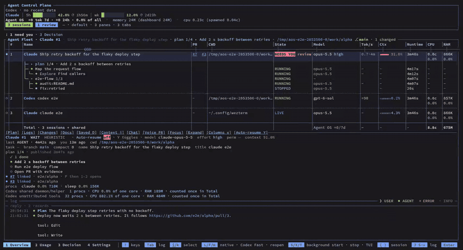

# Agent OS demo · Phil Ho

A quick preview of Agent OS, which I build and use daily. The GIF plays at 2x; the MP4 is the full-speed take.

## Agent OS: multi-agent control terminal (WezTerm + Ratatui)

Full video: [media/agent-os.mp4](media/agent-os.mp4) (50 s)

- One keyboard-driven dashboard for many Claude Code and Codex sessions: fleet with sub-agent and workflow trees, live tokens/s, context, CPU and RAM per session.
- Agents publish plans and ask questions through a CLI protocol. Questions land in one Decision inbox with options, a recommended answer and notes. Dangerous tool calls are held for approval.
- Session viewer with Plan, Logs, Changes and Docs. A usage ledger counts each response once, plus cross-agent verification (Claude grades Codex and Codex grades Claude).
- Core contracts verified in **Lean 4**: 57 kernel-checked theorems over the usage ledger, plan acknowledgement, document ownership, HTML escaping and the render-cache paths. They use no `sorry` and only standard axioms. The plan proof found a real bug: acknowledgement checked parent steps only. The fix shipped with an end-to-end regression test.
- Packaged as plugins and configs: an Agent OS Claude Code plugin, a WezTerm workspace manager with session restore, Jev prompt review (Alt+G) and compaction, and one installer that merges Claude Code and Codex settings, hooks and permissions, backing up each file it changes.
- Runs on Linux, macOS, native Windows 11 and WSL2.

Shown: the fleet overview, the plan viewer, the logs, the Decision page with a pending question, the key search and Zen mode. The sessions are the repo's end-to-end test fixture (synthetic agents), so no real work is exposed. Agent OS source is private.
